# 한국어 공감 표현 멀티모달 데이터셋 검증 및 베이스라인 파이프라인 (AEVDES)

아주대학교 공감 표현 멀티모달 데이터셋(**AEVDES**, *The Ajou Empathy-Visual Database of Expression Speech*) 초기 코호트(30명)를 대상으로 엔드투엔드 데이터 정합성 검수(QC) 및 다중 라벨 공감 전략 분류를 수행한 연구 프로젝트입니다.

한국전파진흥협회(RAPA) 및 대학ICT연구센터(ITRC) 연계 과제로 수행했으며, 대면 인터뷰 멀티모달 데이터(Video · Audio · EEG · BPM/GSR) 수집 프로토콜 설계부터 해시/무음 정량 QC, 참가자 독립 교차검증(Subject-wise GroupKFold) 베이스라인 구축까지의 전체 파이프라인을 포함합니다.

---

## 1. Project Overview

기존 정서 데이터셋(RAVDESS 등)이 통제된 대본 연기를 바탕으로 화자가 **"무엇을 느꼈는가(단일 정서 인식)"**를 분류하는 데 그쳤다면, **AEVDES**는 실제 상담·상호작용 맥락에서 화자가 타인에게 **"어떻게 반응했는가(공감 표현 전략 및 강도)"**를 다중 라벨로 구조화한 한국어 자발적 발화 멀티모달 데이터셋입니다.

본 프로젝트에서는 모델 학습에 앞서 현장 수집 원시 데이터의 중복·무음·센서 결측을 정량적으로 분리(QC)하고, 소규모 표본 환경에서 과적합을 통제한 모달리티별 독립 베이스라인과 교란 변수(발화 길이) Ablation 검증을 통해 데이터의 실질적 특성과 멀티모달 결합의 당위성을 규명했습니다.

### Dataset & Modality Specifications

| 항목 | 설계 프로토콜 기준 | 보관본 실물 검수 및 QC 결과 |
| :--- | :--- | :--- |
| **Cohort & Protocol** | 초기 대면 참가자 30명 (IRB 동의) | 자기 경험 회상 + 영상 자극(6편) 시청 후 자유 발화 세그먼트 |
| **Video (안면 영상)** | 1920×1080 / 30 fps | MP4 인벤토리 **388개** (Audio와 1:1 매칭 확인) |
| **Audio (발화 음성)** | 48kHz WAV 녹음 기준 | MP3(44.1kHz Stereo) **388개** → 중복 통합 **333개** → 무음 제외 **323개 유효** |
| **EEG (뇌파 반응)** | Muse 2 / 256Hz 샘플링 | CSV 111개 중 **99개 유효 (89.19%)** — Flat 채널·결측 QC 완료 |
| **BPM / GSR (생체신호)** | NeuLog 센서 / 10Hz 기록 | 분할 CSV 72개 중 **58개 유효 (80.56%)** — 생리적 정상 범위 QC 완료 |
| **Expert Annotation** | 심리학 전문가 3인 독립 판정 | 다중 라벨 합의 벡터 (Fleiss' Kappa $\kappa = 0.57 \sim 0.68$) |
| **7-Token Identifier** | `02-03-01-01-01-01-01.MP3` | 모달리티-공감유형-강도-질문구분-복수라벨수-발화순번-참가자ID |

### Empathy Taxonomy & Target Distribution ($N = 333$ Unique Utterances)

| 코드 | 공감 유형 | 세부 전략 수 | 주요 반응 내용 | 고유 발화 분포 | 모델링 활용 구분 |
| :---: | :--- | :---: | :--- | :---: | :--- |
| `01` | **집중 (Neutral)** | 3개 전략 | 맞장구 · 반복 · 재진술 | 18건 | 비타겟 (`[0,0,0]` Negative Sample 유지) |
| `02` | **명료화 (Clarifying)** | 3개 전략 | 추가 질문 · 의미 확인 | 7건 (2.1%) | 비타겟 (`[0,0,0]` Negative Sample 유지) |
| `03` | **도와주기 (Helping)** | 4개 전략 | 해결책 제안 · 관점 제시 | **187건** | **예측 타겟 (Target 1)** |
| `04` | **지지하기 (Supporting)** | 6개 전략 | 정서 공유 · 고민 수용 | **63건** | **예측 타겟 (Target 2)** |
| `05` | **격려하기 (Encouraging)** | 5개 전략 | 칭찬 · 힘내기 · 안심 | **111건** | **예측 타겟 (Target 3)** |

> 동일 발화가 조언(`03`)과 격려(`05`)를 동시에 포함하는 사례가 빈번하므로 단일 라벨을 강제하지 않고 **Multi-label 이진 벡터**로 모델링했습니다. 표본이 적은 `01`·`02` 전용 발화(24건)는 임의 삭제하지 않고 타겟 3종이 모두 `0`인 음성 사례(Negative Sample)로 학습에 유지했습니다.

---

## 2. Validation & Modeling Pipeline

### Step 01. 7-Token Schema Verification & SHA-256 Deduplication
- 단일 공감 코드별로 개별 저장된 388개 MP3 파일의 5번째 토큰(복수 라벨 수)과 실제 오디오 바이트의 `SHA-256` 해시를 교차 검증하여 명명 오류를 교정하고 **50개 복수 라벨 그룹(333개 고유 발화, 중앙값 9.42초 / 최대 89.08초)**을 복원했습니다.

### Step 02. Multi-modal Signal Quality Control (QC)
- **Audio QC:** 디코딩 파형 에너지 검사(`RMS < -80 dBFS` 또는 `Peak < -60 dBFS`)를 통해 녹음 무음 오류 10건을 분리하여 **최종 323개 유효 표본**을 확정했습니다.
- **Bio-signal QC (`src/eeg_quality_check.py`, `src/bpm_quality_check.py`):** 파일 존재 여부와 실제 신호 품질을 엄격히 분리하여 Flat 채널(`std < 1e-6`), 결측률(`>30%`), 심박 정상 범위(`30~220 BPM`) 이탈 여부를 정량 판별했습니다.

### Step 03. Modality-Specific Baselines (Audio & Video)
- **Audio Baseline (`src/audio_baseline.py`):**
  - `FFmpeg` 메모리 파이프 디코딩(16kHz Mono) 후 25ms 윈도우 / 10ms 홉 기준 **34차원 음향 통계 벡터**(13 MFCC 평균·표준편차 26D + RMS · ZCR · Spectral Centroid · Spectral Flatness 평균·표준편차 8D) 추출
  - `StandardScaler` + `OneVsRestClassifier(LogisticRegression(class_weight="balanced"))` 학습
- **Video Baseline (`src/video_baseline.py`):**
  - 발화 세그먼트 MP4에서 균등 간격 16프레임 샘플링(`Uniform Frame Sampling`) 후 ImageNet 사전학습 `ResNet18`로 512차원 공간 특징 추출 및 시간축 평균 풀링(`Temporal Mean Pooling`) 수행

### Step 04. Subject-wise 5-Fold Cross Validation (`src/evaluation.py`)
- 동일 참가자의 발화가 학습(Train)과 검증(Validation) 폴드에 동시에 포함되는 화자 정보 누출(Speaker Leakage)을 차단하기 위해 참가자 ID 기준 `GroupKFold(n_splits=5)`로 평가했습니다.

---

## 3. Key Findings

### Empirical Performance & Confounding Factor Ablation ($N = 323$)

| 비교 모델 | 유효 표본 | Macro-F1 | Micro-F1 | Exact Match | Hamming Acc. | 비고 |
| :--- | :---: | :---: | :---: | :---: | :---: | :--- |
| **Audio: Dummy Baseline** | 323 | 0.239 (23.90%) | - | - | - | 학습 폴드 라벨 빈도 기준선 |
| **Audio: 34D MFCC + OvR LR** | 323 | **0.430 (42.98%)** | **0.462 (46.15%)** | **22.60%** | **55.93%** | 참가자 독립 5-Fold 실측 완료 |
| **Ablation: Duration-only + LR** | 323 | **0.447 (44.70%)** | - | - | - | $\log(1+\text{초})$ 발화 길이 단일 변수 대조군 |
| **Video: 16-Frame ResNet18 + OvR LR** | - | - | - | - | - | 재현 실험 파이프라인 코드 구축 |

### Core Engineering Insights
- **교란 변수(발화 길이) 효과 규명:** 복수 공감 전략이 포함된 발화일수록 물리적 발화 시간이 길어지는 특성으로 인해, 34차원 음향 특징 모델(`Macro-F1 0.430`)보다 발화 길이 단일 변수 모델(`Macro-F1 0.447`)이 더 높은 설명력을 보였습니다. 이는 음성 운율 정보만으로는 구체적인 공감 전략(해결책 제안 vs 정서적 지지)을 구분하는 데 한계가 있음을 실증하며, 텍스트(언어 의미) 및 영상(안면 표정) 멀티모달 결합의 당위성을 뒷받침합니다.
- **선행연구(RAVDESS)와의 문제 정의 차별화:** 통제된 단문 대본과 배우의 연기를 기반으로 단일 감정을 분류하는 RAVDESS(Multi-class Accuracy 평가)와 달리, 비정형 자발적 발화에서 복합 공감 전략을 예측하는 AEVDES(Multi-label F1 평가)는 문제 난이도와 평가 척도가 본질적으로 다름을 체계화했습니다.

---

## 4. Portfolio Slides

연구 수행 프로세스부터 데이터 스키마 복원, 정량 QC, 베이스라인 검증 및 선행연구 비교까지 13장의 슬라이드로 정리했습니다.

### 00. End-to-End Research & Data Validation Process
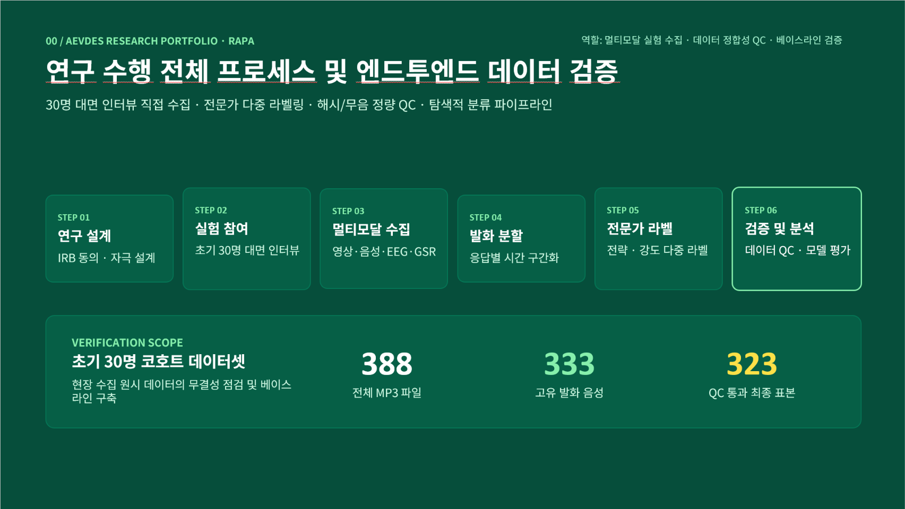

### 01. Research Background (Why AEVDES?)
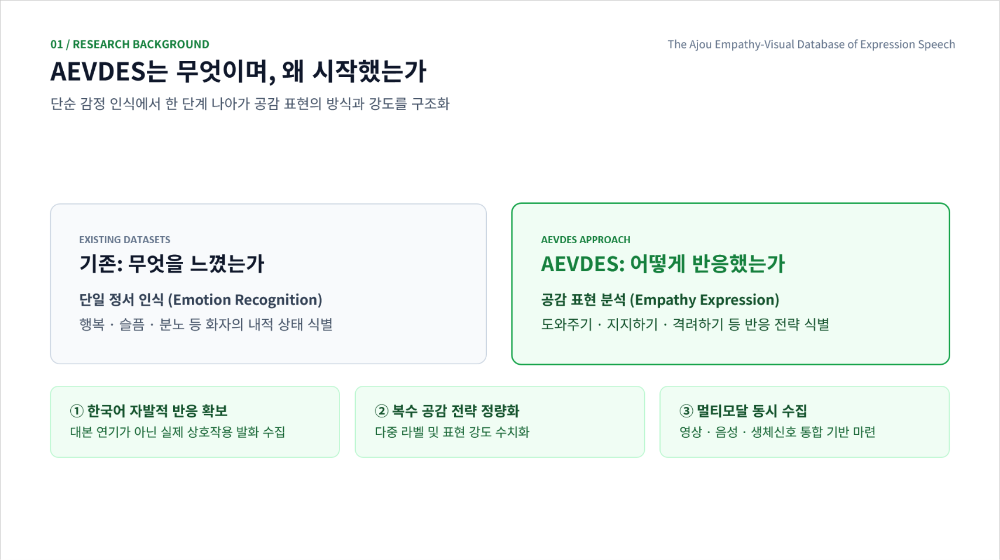

### 02. Empathy Taxonomy & Target Class Distribution
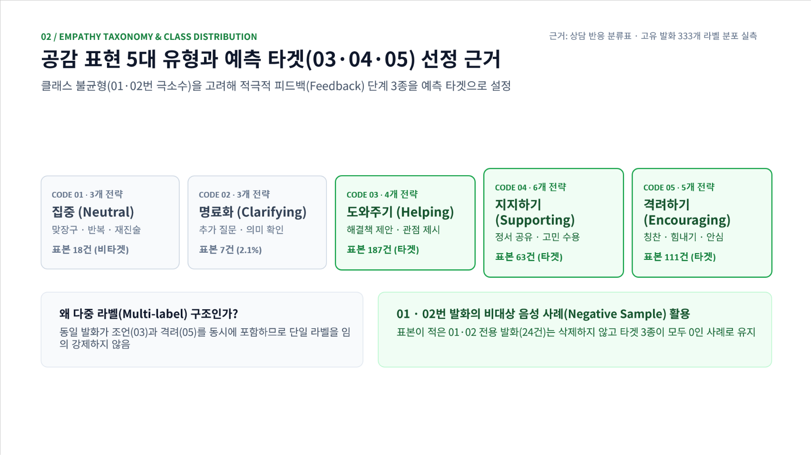

### 03. Experimental Plan & Interview Protocol
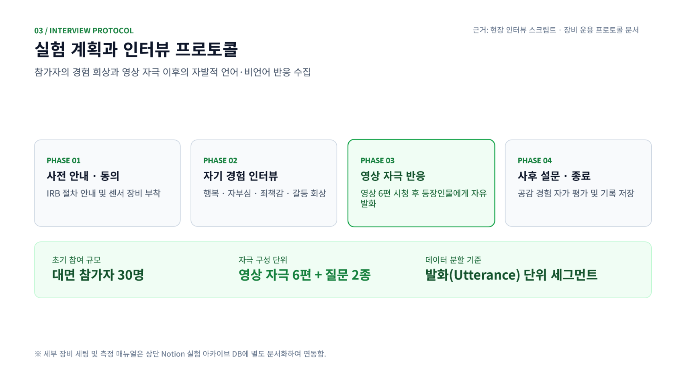

### 04. Multimodal Environment & Hardware Specifications
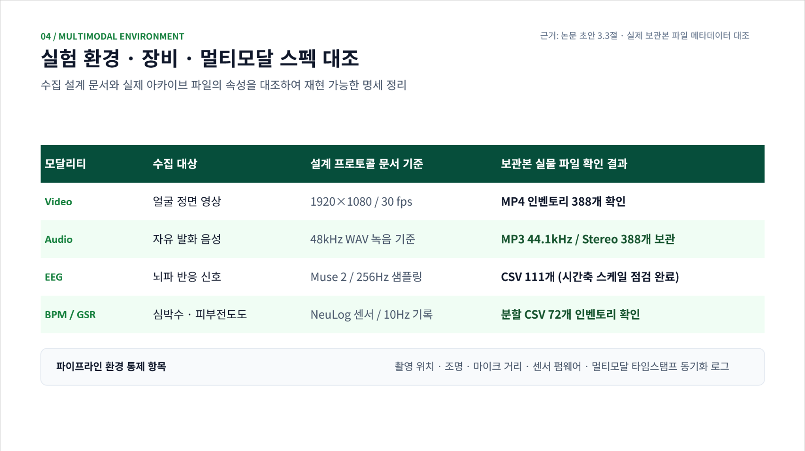

### 05. Data Schema & 7-Token Identifier Rules
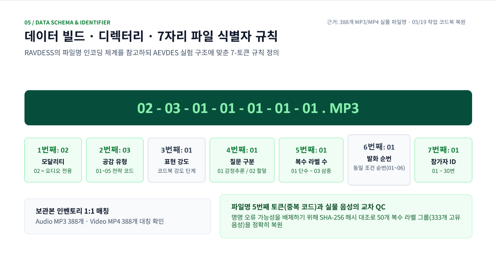

### 06. Expert Annotation & Inter-Annotator Reliability
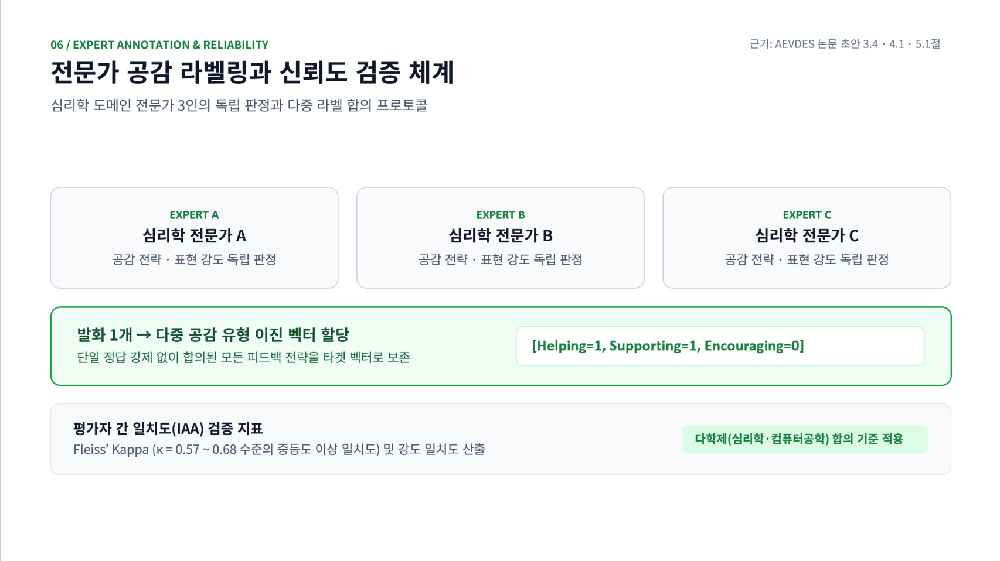

### 07. Audio Data EDA, Hash Deduplication & Silence QC
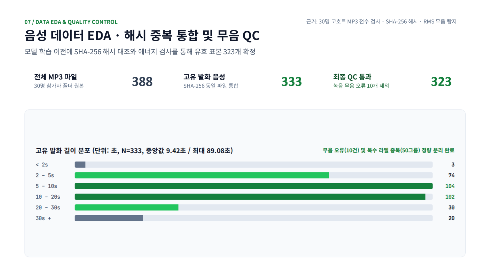

### 08. Audio-only Baseline Pipeline Architecture
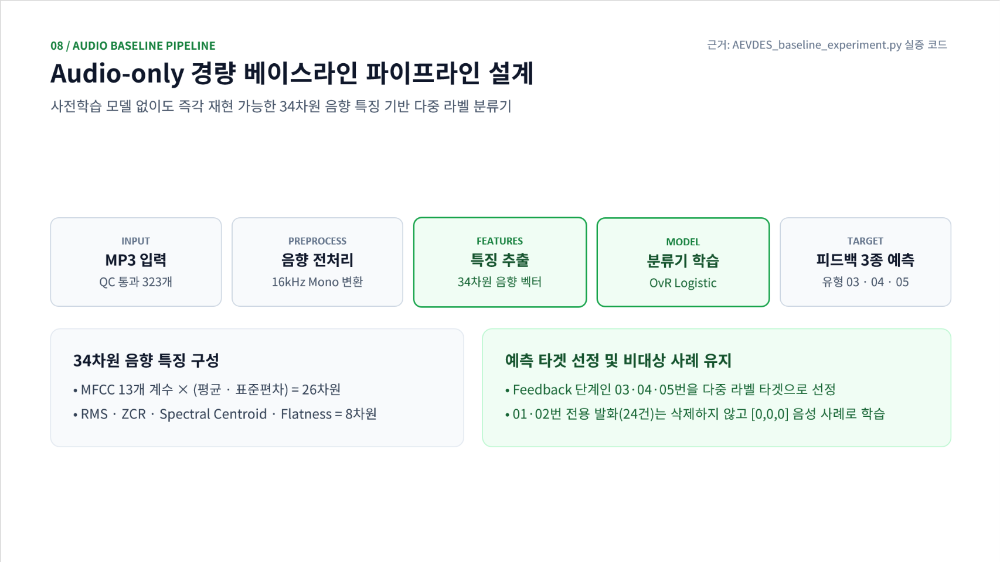

### 09. Subject-wise GroupKFold Validation Strategy
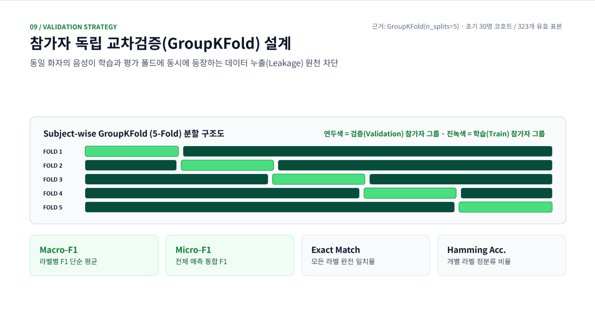

### 10. Empirical Performance & Duration Ablation
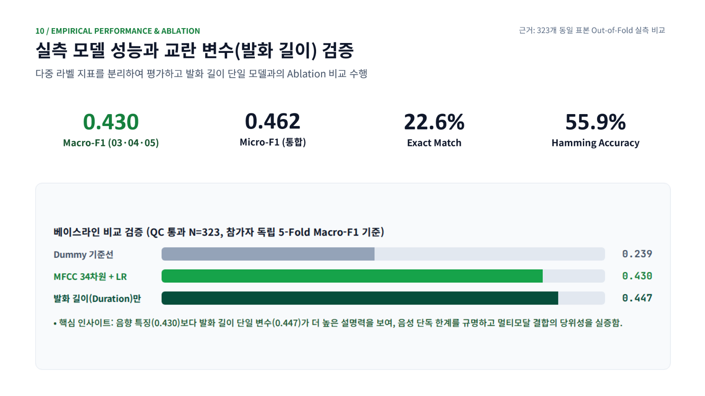

### 11. Literature Benchmark Scope (RAVDESS vs. AEVDES)
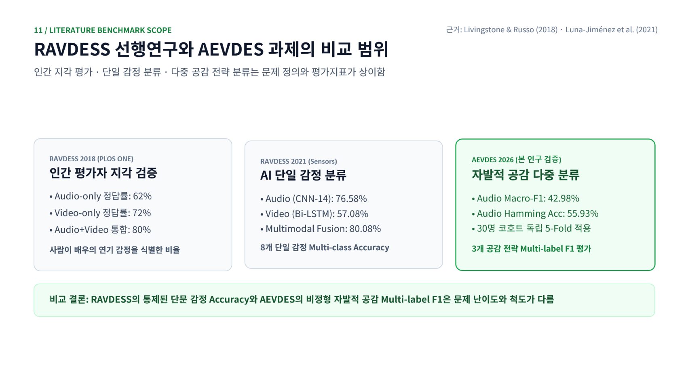

### 12. Bio-signal Quantitative QC & Future Work
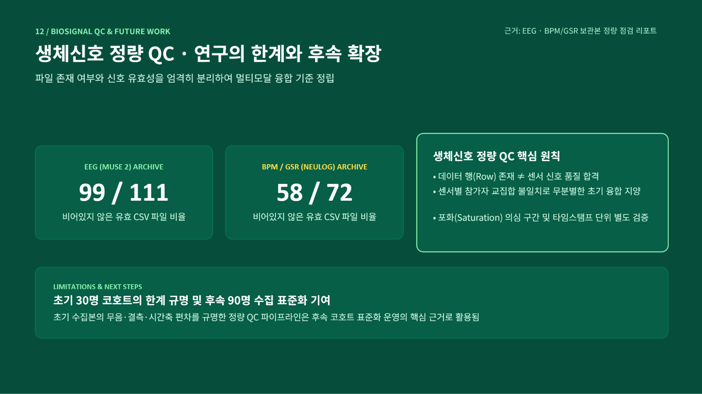

---

## 5. Repository Structure

```text
RAPA_AEVDES/
├── sample_data/
│   └── sample_metadata.csv     # 파이프라인 입력 메타데이터 스키마 예시 (개인정보 제외)
├── slides/                     # 연구 포트폴리오 슬라이드 이미지 (1.png ~ 13.png)
├── src/
│   ├── audio_baseline.py       # FFmpeg 파이프 디코딩 · 34D 음향 특징 추출 · GroupKFold 평가
│   ├── video_baseline.py       # 16프레임 균등 샘플링 · ResNet18 특징 추출 · GroupKFold 평가
│   ├── eeg_quality_check.py    # Muse 2 뇌파 CSV 정량 품질 검수 (Flat 채널 · 결측률)
│   ├── bpm_quality_check.py    # NeuLog 심박/GSR CSV 정량 품질 검수 (생리적 정상 범위)
│   └── evaluation.py           # 다중 라벨 평가지표 (Macro/Micro-F1, Exact Match, Hamming Acc.)
├── .gitignore
├── requirements.txt
└── README.md
```

---

## 6. Getting Started

### System Dependency (FFmpeg)
`src/audio_baseline.py`는 디스크에 임시 WAV를 생성하지 않고 `subprocess`를 통해 `ffmpeg`를 메모리 파이프로 직접 호출합니다. 실행 전 시스템 `PATH`에 `ffmpeg`가 설치되어 있어야 합니다.

```bash
# Ubuntu / Debian
sudo apt-get install ffmpeg

# macOS
brew install ffmpeg

# Windows (winget)
winget install Gyan.FFmpeg
```

### Installation

```bash
git clone [https://github.com/yundongmin/RAPA_AEVDES.git](https://github.com/yundongmin/RAPA_AEVDES.git)
cd RAPA_AEVDES

python -m venv .venv
# Windows: .venv\Scripts\activate | macOS/Linux: source .venv/bin/activate
pip install -r requirements.txt
```

### Run Pipelines

```bash
# 1) Audio Baseline (SHA-256 중복 통합 + 무음 QC + 34D MFCC + 참가자 독립 5-Fold CV)
python src/audio_baseline.py \
  --archive /path/to/30_Participants_MP3.zip \
  --output results/audio

# 2) Video Baseline (16-Frame Uniform Sampling + ResNet18 + 참가자 독립 5-Fold CV)
python src/video_baseline.py \
  --metadata sample_data/sample_metadata.csv \
  --video-root /path/to/video_root \
  --output results/video

# 3) EEG 및 BPM/GSR 생체신호 정량 품질 검수 (QC)
python src/eeg_quality_check.py --input /path/to/EEG_Folder --output results/eeg_qc
python src/bpm_quality_check.py --input /path/to/BPM_Folder --output results/bpm_qc
```

---

## 7. Implementation Notes & Limitations.

- **개인정보 및 원본 데이터 보호:** 대면 인터뷰 참가자의 얼굴 영상(MP4)과 원본 음성(MP3)은 연구윤리(IRB) 및 초상권 보호 기준에 따라 공개 저장소에 포함하지 않았으며, `sample_data/sample_metadata.csv`를 통해 데이터 인터페이스와 다중 라벨 구조를 확인할 수 있습니다.
- **후속 코호트 표준화 기여:** 초기 30명 코호트에서 규명한 파일 명명 불일치(5번째 중복 토큰 오류), 녹음 무음(10건), 센서별 수집 범위 편차 및 시간축 스케일 점검 기준은 후속 대규모 코호트(90명 확장 수집) 데이터셋의 수집·검수 표준화 근거로 활용되었습니다.